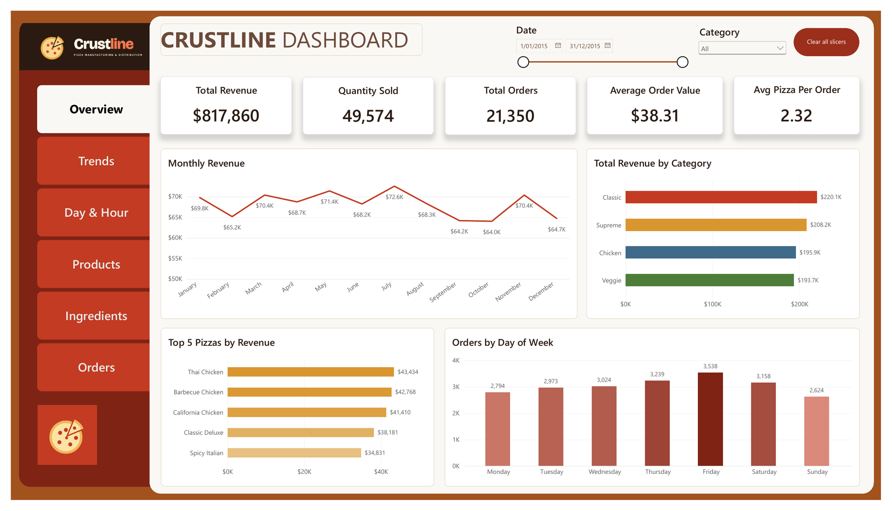
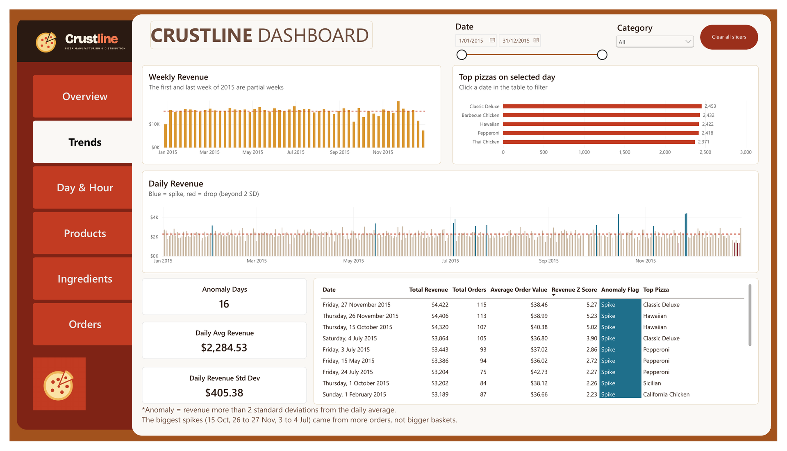
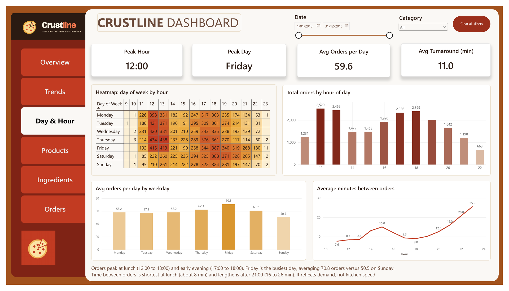
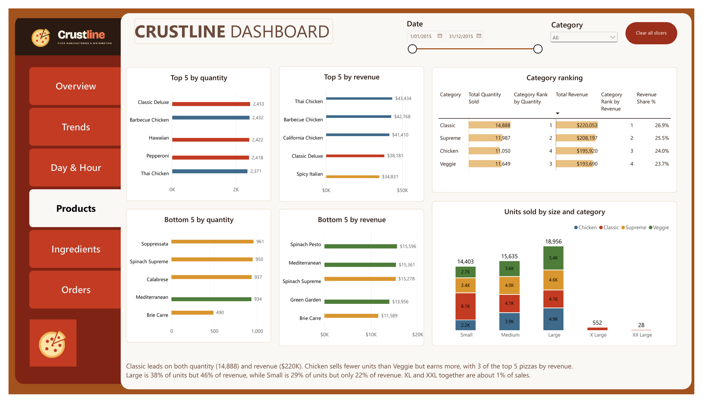
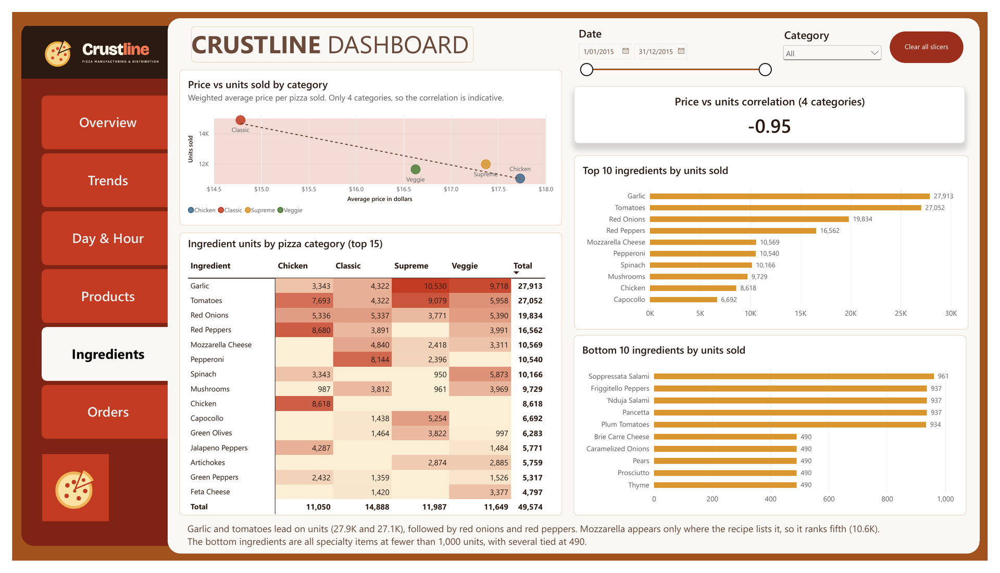
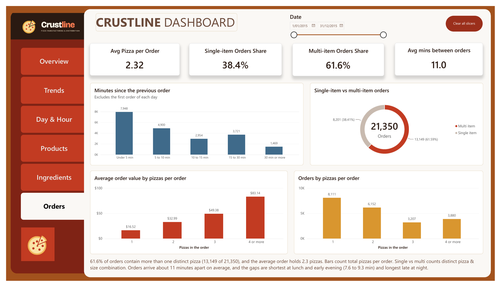
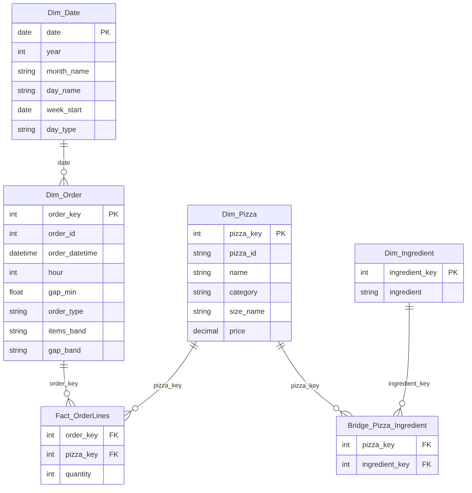

# Crustline | Pizza sales analysis in Power BI

An end-to-end Power BI project on one year of pizza orders for a fictional pizza maker and distributor: a raw CSV imported untouched, cleaned and shaped in Power Query, modeled as a star schema with a many-to-many ingredient bridge, measured in DAX and delivered as a six-page interactive report. Headline figures were recomputed from the raw CSV outside Power BI and the rest were checked for internal consistency (see the QA checklist).

**Start here:** [Report PDF](docs/Crustline_Pizza_report.pdf) | [Report file (Releases)](../../releases) | [Findings](docs/analysis_insights.md) | [Power Query steps](powerbi/power_query.md) | [DAX measures](powerbi/dax_measures.md) | [Definitions](docs/definitions.md) | [QA checklist](docs/qa_checklist.md)

**Open it:** download the `.pbix` from [Releases](../../releases), or read the [report PDF](docs/Crustline_Pizza_report.pdf).

**Business brief.** Crustline sells pizzas in four categories and five sizes. Leadership wants to know five things. How much did we sell and was the year steady? Which days and hours are busy? Which pizzas, sizes and ingredients carry the business? Do cheaper pizzas sell more? How do customers build their orders? The report answers these in six pages.

**Scale:** 48,620 order lines, 21,350 orders, 49,574 pizzas, 91 pizza and size combinations (32 pizza names, 4 categories, 5 sizes), 65 ingredients, 1 January to 31 December 2015.

## What this project shows
- **Power Query:** one raw CSV imported as is, then typed, text-cleaned, size names derived, ingredients split into rows, a garbled ingredient name repaired and an order-to-order time gap built, all in M.
- **Data modeling:** star schema with a marked date table, a many-to-many bridge between pizzas and ingredients, hidden keys and helper columns, and display folders for measures.
- **DAX:** 37 measures for KPIs, anomaly detection (z-score over daily revenue), rankings, shares, order behaviour, peak hour and day, and a hand-written Pearson correlation.
- **Analysis:** trends and anomalies, day and hour demand, product and size mix, ingredient popularity, price against volume, order size and time between orders.
- **Report design:** custom theme and palette, left navigation, synced date and category slicers, one fixed colour per pizza category, and a short takeaway under each analysis page.
- **Analytical judgement:** the data covers one year, has no costs and no customer ids, so the project states what it can and cannot support.

## Headline findings
| # | Finding | Evidence | Where |
|---|---|---|---|
| 1 | The year was steady, not growing | $817,860 revenue, 49,574 pizzas, 21,350 orders. Monthly revenue stays between $64.0K (October) and $72.6K (July). Per trading day the months are within about 7% of each other ($2,157 in December to $2,370 in October), because October has four empty Mondays | Overview |
| 2 | 16 unusual days, 11 spikes and 5 drops | Days beyond 2 standard deviations of the daily average ($2,284.53 over 358 trading days). Biggest spikes: 27 Nov ($4,422), 26 Nov ($4,406), 15 Oct ($4,320), 4 Jul ($3,864). The biggest spikes came from more orders, not bigger baskets. Three of the five drops fall in the last week of December. A 2 standard deviation rule flags about 1 day in 22 even by chance, and it ignores the weekday pattern (6 of the 11 spikes are Fridays, 3 of the 5 drops Sundays), so only the three days above 5 standard deviations clearly stand out | Trends |
| 3 | Two daily peaks, and Friday leads | Orders peak in the 12:00 hour (2,520) and 13:00 hour (2,455), and again in the 17:00 (2,336) and 18:00 (2,399) hours. Friday averages 70.8 orders per trading day against 50.5 on Sunday | Day & Hour |
| 4 | Gaps between orders stretch late in the evening | Average gap is 11.0 minutes, about 8 at lunch, 16 to 26 minutes after 21:00 (the 23:00 figure rests on 28 orders) | Day & Hour |
| 5 | Classic wins on volume, Large wins on revenue | Classic is 30.0% of pizzas and 26.9% of revenue ($220.1K) at the lowest average price ($14.78). Large is 38.2% of pizzas and 45.9% of revenue | Products |
| 6 | A few pizzas lag far behind | Brie Carre sold 490 pizzas ($11.6K) against 2,453 for the best seller. The lowest-volume ingredients sell exactly as many pizzas as the slowest pizzas that use them (for example five ingredients at 490, all in Brie Carre) | Products, Ingredients |
| 7 | Cheaper categories sell more, on four data points | Across the four categories, average price and pizzas sold have a correlation of -0.95, but Classic alone drives it: without Classic the other three give -0.47. Four points make this a hint, not proof | Ingredients |
| 8 | Most orders hold several pizzas | 61.6% of orders contain more than one distinct pizza and size. Average order value rises from $16.52 (1 pizza) to $83.14 (4 or more), about $16 per extra pizza | Orders |

The full write-up is in [`docs/analysis_insights.md`](docs/analysis_insights.md).

## Recommendations
1. Staff and prepare for the 12:00 to 13:59 and 17:00 to 19:59 windows, which hold 55% of orders, and plan extra capacity for Fridays.
2. Check whether the spike days recur (4 July, 15 October, 26 and 27 November) before planning around them. Thanksgiving moves each year and 15 October has no known cause.
3. Test bundles and add-ons on the 38.4% of orders that hold a single pizza and size. Order value rises with basket size, but the data cannot show that offers would lift it.
4. Test featuring Large first. It earns 45.9% of revenue from 38.2% of pizzas, but that is revenue only, since margin is unknown.
5. Review the bottom of the menu, starting with Brie Carre, and check its sizes and ingredient wastage before deciding to drop it.
6. Test a small price rise on Classic before acting on the price relationship. Classic sells the most at the lowest price, and four categories are too few to be sure.
7. Aim promotions at the soft spots: Sundays, and December, the weakest month per trading day (about $2,157 against $2,285 for the year).

## The report
Page 1 (Overview) is shown at the top. The other five pages:

<table>
<tr>
<td width="33%"> <b>2. Trends</b> Weekly and daily revenue and the 16 anomaly days.</td>
<td width="33%"> <b>3. Day & Hour</b> Busiest days and hours, and the time between orders.</td>
<td width="33%"> <b>4. Products</b> Top and bottom pizzas, category ranking, units by size.</td>
</tr>
<tr>
<td width="33%"> <b>5. Ingredients</b> Ingredient volumes and price against units sold.</td>
<td width="33%"> <b>6. Orders</b> Single and multi pizza orders, order value, time since the last order.</td>
<td width="33%"></td>
</tr>
</table>

- **Open the report:** download `Crustline_Pizza.pbix` (about 1 MB) from the [Releases page](../../releases) and open it in Power BI Desktop. The data is imported, so the file opens without any source. Refreshing needs your own copy of the CSV, see "Run it yourself".
- **No Power BI?** A PDF of all six pages is in [`docs/Crustline_Pizza_report.pdf`](docs/Crustline_Pizza_report.pdf).

## Data model

Orders are stored once in `Dim_Order` (with date, hour and the gap since the previous order) and order lines in `Fact_OrderLines`. `Dim_Date` filters orders. `Dim_Pizza` filters order lines and, through `Bridge_Pizza_Ingredient`, `Dim_Ingredient`, so ingredient volumes are the pizzas sold that contain each ingredient. That bridge is many to many and filters in both directions. Details are in [`powerbi/data_model.md`](powerbi/data_model.md).

## How the numbers were checked
Totals were recomputed from the raw CSV with a separate script (rows, orders, pizzas, revenue, trading days, anomaly count, single and multi orders, category and size splits). Other figures were checked against the sum of their parts (weekday, hour, size), order counts across four different splits, the time-gap buckets against orders minus first orders of each day and the correlation recomputed by formula. All 23 checks in [`docs/qa_checklist.md`](docs/qa_checklist.md) pass, and the list says what was not checked. Problems found along the way are recorded in [`docs/data_quality_report.md`](docs/data_quality_report.md), for example a garbled ingredient name and a simple average price that disagreed with the units actually sold.

## Decisions and limitations
- **One year only:** the data covers 2015, so there is no year-on-year view. The first and last week of the year are partial weeks.
- **No cost data:** revenue is quantity times list price, so this is a sales analysis, not a profit analysis.
- **Revenue definition:** price comes from the size-specific price list, with no discounts or taxes.
- **Trading days:** 358 of 365 days have orders. The seven empty days (24 and 25 September, 25 December, and four Mondays in October) are excluded from daily averages and the anomaly test. The data does not say whether they are closures or missing data. If they are missing data, revenue is understated.
- **Anomalies are statistical:** a day beyond 2 standard deviations is flagged. The data has no event calendar, so causes such as public holidays are only hypotheses.
- **Price against volume:** the correlation is across four categories only, using the quantity weighted average price, so it is indicative.
- **Ingredients as recorded:** ingredient counts use the ingredient list in the data exactly. Mozzarella is listed for three of four categories and tomato sauce is not listed at all, so no base ingredient is assumed.
- **Single order definition:** an order is single when it holds one distinct pizza and size (one order line), whatever the quantity. The order-size charts count total pizzas per order instead, so the first bar is 8,111, not 8,201.
- **Time between orders:** measured from the previous order the same day, and the first order of each day has no gap.
- **Source path:** the released file holds a placeholder path in one parameter, `SourceFilePath`, so a refresh needs that value pointed at your CSV.

## What I would do next
- Add cost and margin data to move from sales to profit.
- Add more years so seasonality and growth can be separated.
- Compare the spike days with a holiday and weather calendar.
- Run a price test on Classic and a bundle test on single pizza orders before scaling either.

## Run it yourself
1. **Get a CSV** with the same ten columns as the source (order_id, date, time, pizza_id, quantity, size, price, name, category, ingredients). The source file is not included here.
2. **Open `Crustline_Pizza.pbix`** from the Release in Power BI Desktop.
3. **Repoint the source:** Home, Transform data, select the `SourceFilePath` parameter and set it to the full path of your CSV. Both source queries read it.
4. **Refresh.** Figures will match this README only if the file holds the same rows. To rebuild from scratch, follow [`powerbi/power_query.md`](powerbi/power_query.md), [`powerbi/data_model.md`](powerbi/data_model.md) and [`powerbi/dax_measures.md`](powerbi/dax_measures.md).

## Repository guide
| Folder | Contents |
|---|---|
| `powerbi/` | Power Query steps, data model, all DAX measures, report guide |
| `docs/` | Findings, definitions, data dictionary, data quality report, QA checklist, ERD, screenshots and report PDF |

## Tools
Power BI Desktop, Power Query (M), DAX.

## About
Built by **Minh Phuc Le** as a portfolio project for Data Analyst roles.

- LinkedIn: [minh-phuc-le-luke](https://www.linkedin.com/in/minh-phuc-le-luke/)
- Email: minhphucle.luke@gmail.com

"Crustline" is a fictional brand name used for presentation. The code and documents in this repository are released under the MIT license (see `LICENSE`).
