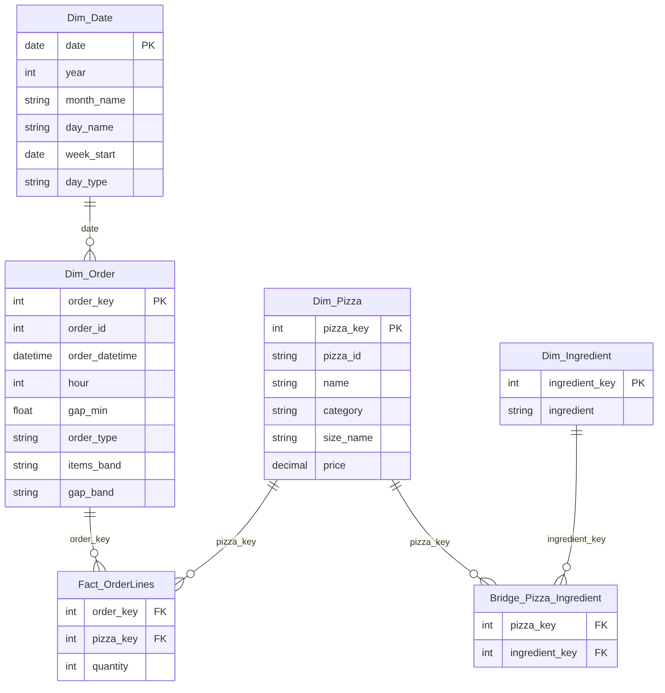

# Data model

## Tables

| Table | Rows | Grain | Notes |
|---|---|---|---|
| `Fact_OrderLines` | 48,620 | One order line | `quantity` plus `order_key` and `pizza_key`. All columns hidden |
| `Dim_Order` | 21,350 | One order | Date, time, hour, gap since the previous order, order type, size bands |
| `Dim_Pizza` | 91 | One pizza at one size | Name, category, size name, price. 32 pizza names, 4 categories, 5 sizes |
| `Dim_Date` | 365 | One day of 2015 | Marked as the date table |
| `Dim_Ingredient` | 65 | One ingredient | |
| `Bridge_Pizza_Ingredient` | 518 | One pizza and ingredient pair | Hidden |
| `_Measure` | 0 | Holds all measures | |

## Relationships

| From (many) | To (one) | Filter direction | Name in model |
|---|---|---|---|
| `Fact_OrderLines[pizza_key]` | `Dim_Pizza[pizza_key]` | Single | Fact_OrderLines to Dim_Pizza |
| `Fact_OrderLines[order_key]` | `Dim_Order[order_key]` | Single | Fact_OrderLines to Dim_Order |
| `Dim_Order[date]` | `Dim_Date[date]` | Single | Dim_Order to Dim_Date |
| `Bridge_Pizza_Ingredient[pizza_key]` | `Dim_Pizza[pizza_key]` | **Both** | Bridge_Pizza_Ingredient to Dim_Pizza |
| `Bridge_Pizza_Ingredient[ingredient_key]` | `Dim_Ingredient[ingredient_key]` | Single | Bridge_Pizza_Ingredient to Dim_Ingredient |

## Design decisions

- **Orders as their own table.** Order level facts (hour, order type, gap since the previous order) belong to the order, not to each line. Keeping them in `Dim_Order` avoids repeating them 48,620 times and lets order level filters work.
- **Why the bridge filters both ways.** An ingredient belongs to many pizzas and a pizza has many ingredients. The ingredient table filters the bridge, the bridge has to pass that filter on to the pizzas, and pizzas filter the order lines, so an ingredient's volume is the pizzas sold that contain it. Passing the filter from the bridge to the pizza table is why that one relationship uses both directions. A category slicer still works in the other direction as usual, because pizzas filter the bridge.
- **Reading ingredient totals.** A pizza with five ingredients counts once under each of them, so ingredient volumes add up to more than total pizzas sold. Use them to rank ingredients, not to add up.
- **Date table.** `Dim_Date` covers every day of 2015 (365 rows) and is marked as the date table, which means days without orders still exist and show as blanks.
- **Hidden fields.** Keys, sort helpers (`size_order`, `dow_num`, `month_num`, `quarter_num`, `gap_band_order`), raw `price` and `quantity` and the bridge table are hidden so report authors use the measures. Numeric columns that should never be summed are set to "Don't summarize".
- **Sort by column.** `size_name` sorts by `size_order` and `gap_band` by `gap_band_order`, so sizes and time buckets keep their natural order.
- **Display folders.** Measures are grouped by report page: Core KPIs, Trends and anomalies, Products and sizes, Ingredients and price, Order behaviour, Tooltips.
